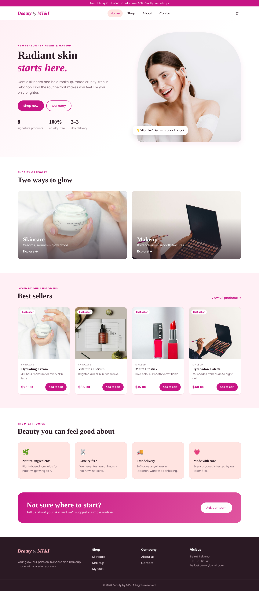
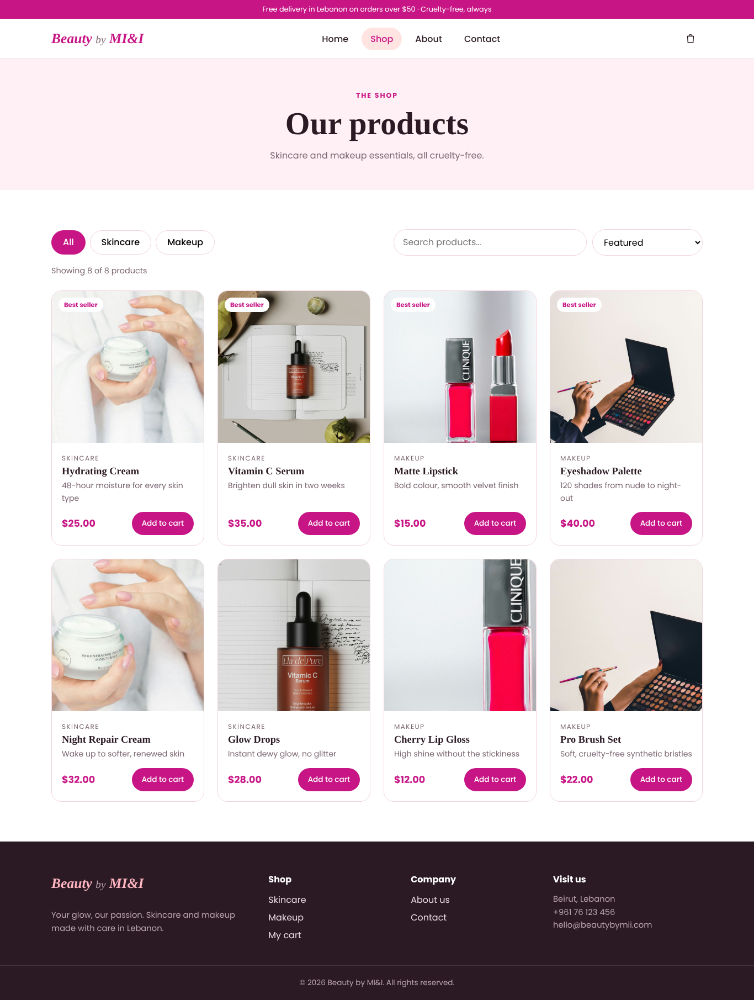
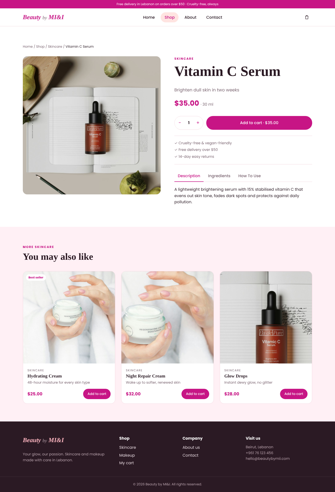
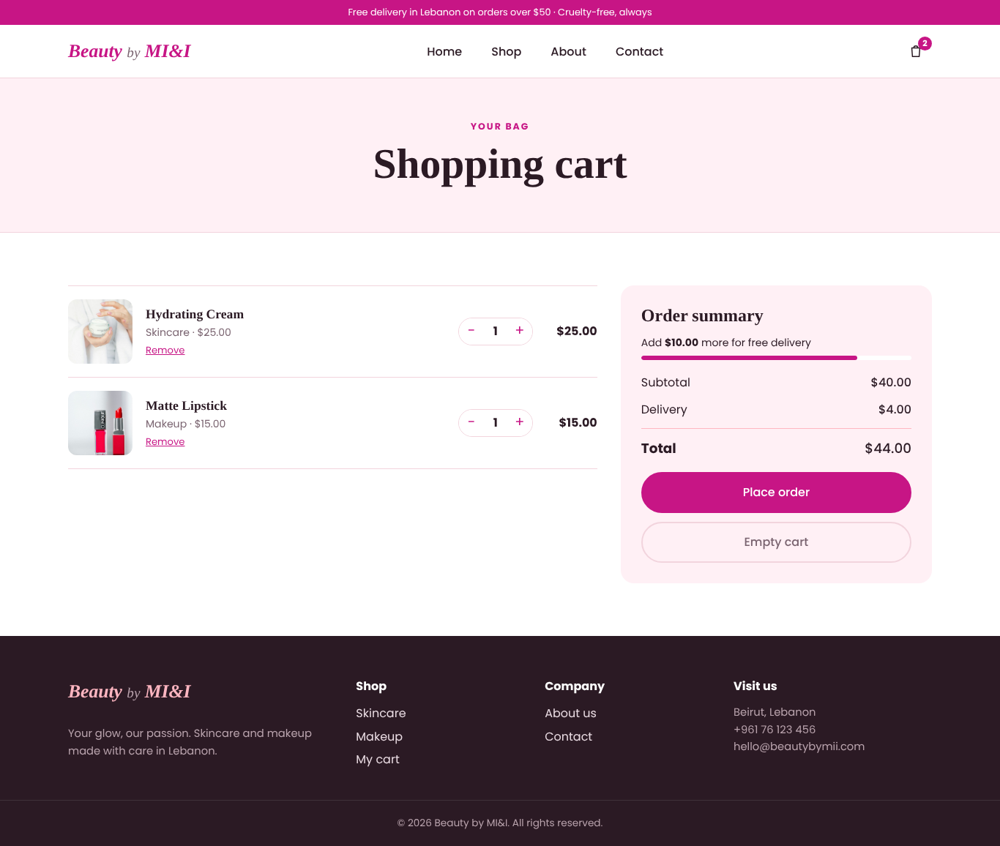
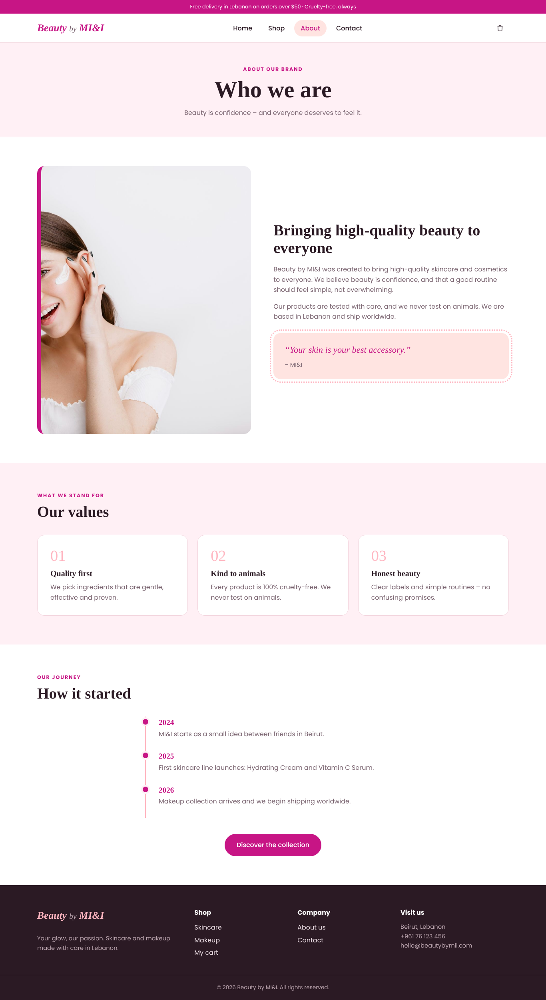
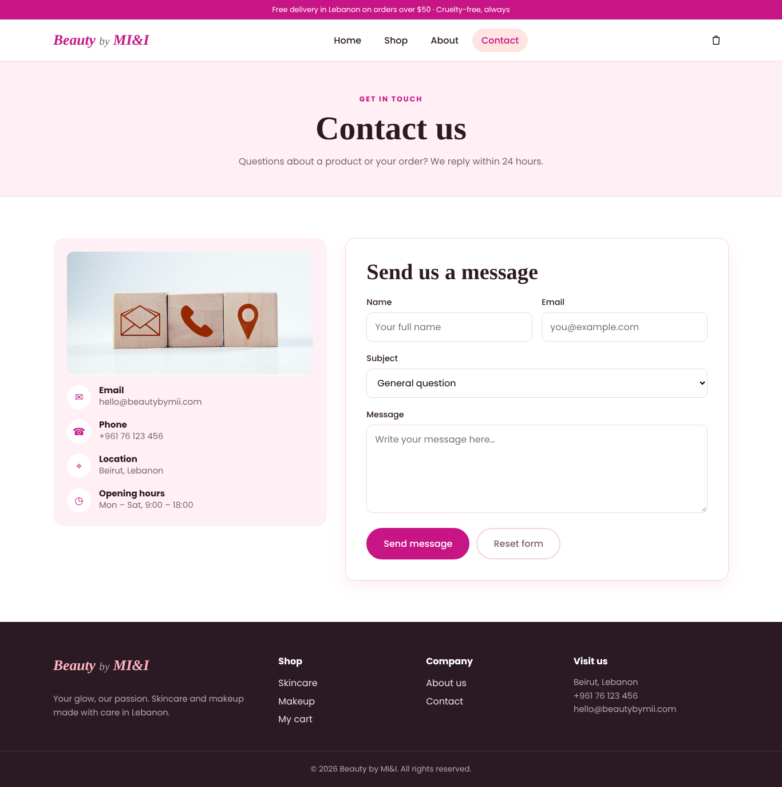
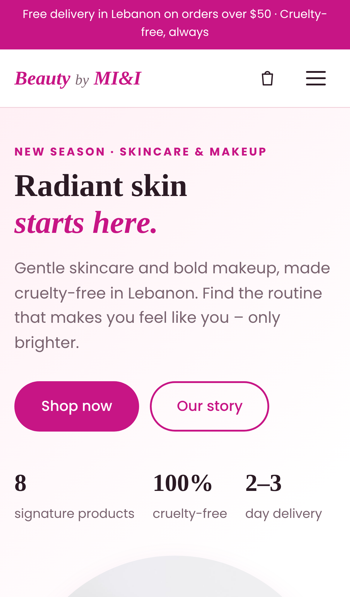
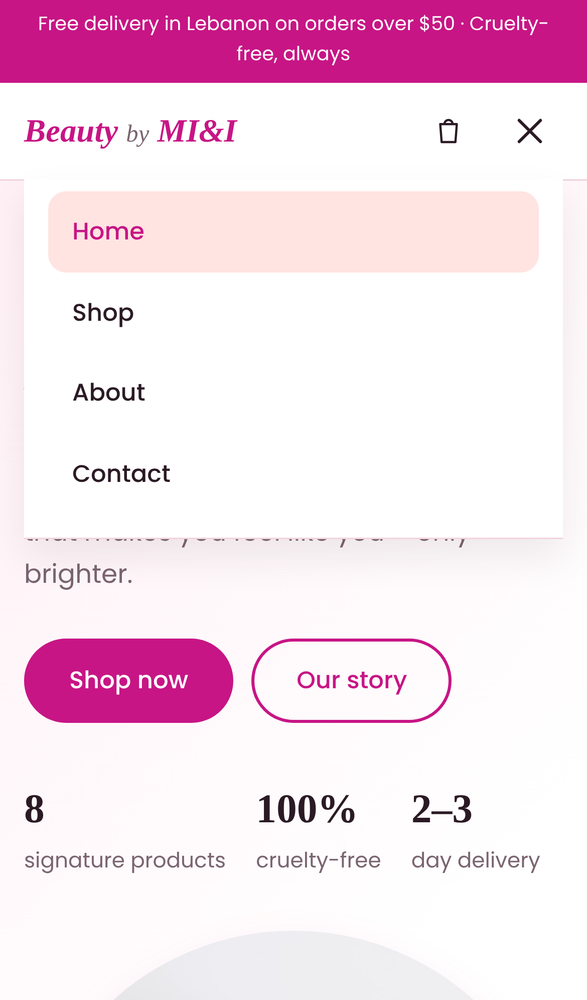
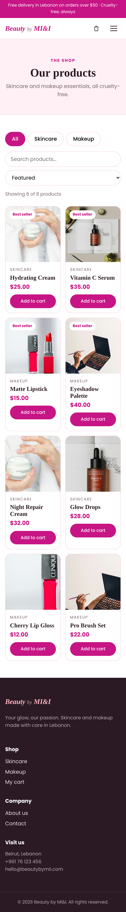
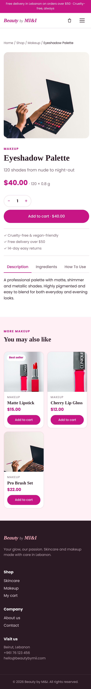

# Beauty by MI&I 💄

A responsive e-commerce frontend for a cruelty-free skincare and makeup brand, built with **ReactJS**.

> **Course:** CSCI426 – Advanced Web Programming · Project Phase 1 · Fall 2026-27
> **Student:** Maha A. Alhussein (individual project)
> **Instructor:** Dr. Walid Amer
> **Live demo:** https://beauty-mii.vercel.app
> **Repository:** https://github.com/22231107-creator/beauty-mi

---

## 📖 Project description

**Beauty by MI&I** started as a static HTML/CSS website in CSCI390 (Web Development). In this course it was rebuilt from scratch as a React single-page application that solves a real-world problem: helping customers **browse, search, compare and order** beauty products online from a small Lebanese brand.

### Features

- 🏠 **Home** – hero section, shop-by-category cards, best sellers, brand promises and call-to-action
- 🛍️ **Shop (Products)** – live search, category filter (Skincare / Makeup) and sorting by price or name
- 🔎 **Product details (dynamic page)** – `/products/:id` loads any product from the URL, with quantity selector, tabs (description / ingredients / how to use) and related products
- 🛒 **Cart** – add, update quantity, remove, free-delivery progress bar, order summary and demo checkout; saved in `localStorage`
- ℹ️ **About** – brand story, values and timeline
- ✉️ **Contact** – contact details and a form with client-side validation and a success message
- 🚫 **404 page** for unknown URLs
- 📱 **Fully responsive** – desktop, tablet and mobile (hamburger menu)

## 🗺️ Pages & routes

| Page | Route | Type |
|---|---|---|
| Home | `/` | Static |
| About | `/about` | Static |
| Shop (Services/Features) | `/products` | Interactive (search, filter, sort) |
| Product details | `/products/:id` | **Dynamic** (URL parameter) |
| Contact | `/contact` | Form + validation |
| Cart | `/cart` | Dynamic (React Context state) |
| Not found | `*` | Fallback |

## 🧰 Technologies

- **React 19** (functional components + hooks: `useState`, `useEffect`, `useMemo`, `useContext`)
- **React Router DOM 6** – client-side routing, `useParams`, `useSearchParams`, `NavLink`
- **Vite** – development server and production build
- **CSS3** – custom properties, Flexbox, CSS Grid, media queries (no UI template)
- **Google Fonts** – Playfair Display + Poppins
- **Git & GitHub** – version control
- **Vercel** – hosting with continuous deployment

## 📁 Folder structure

```
beauty-mii/
├── public/              favicon
├── src/
│   ├── assets/images/   optimized product photos
│   ├── components/      Navbar, Footer, ProductCard, PageHeader, ScrollToTop
│   ├── context/         CartContext (global cart state)
│   ├── data/            products.js (product catalogue)
│   ├── pages/           Home, About, Products, ProductDetails, Contact, Cart, NotFound
│   ├── App.jsx          routes
│   ├── main.jsx         entry point (BrowserRouter + CartProvider)
│   └── index.css        all styles + responsive breakpoints
├── docs/screenshots/    UI screenshots used below
├── vercel.json          SPA rewrite so refreshing /products/2 works
└── package.json
```

## ⚙️ Setup instructions

**Requirements:** [Node.js](https://nodejs.org) 18 or newer and npm.

```bash
# 1. Clone the repository
git clone https://github.com/22231107-creator/beauty-mi.git
cd beauty-mii

# 2. Install dependencies
npm install

# 3. Start the development server
npm run dev
# open http://localhost:5173

# 4. Build for production
npm run build
npm run preview   # test the production build locally
```

### Deploying to Vercel

1. Push the repository to GitHub.
2. On [vercel.com](https://vercel.com) choose **Add New → Project** and import the repo.
3. Vercel detects **Vite** automatically (build command `npm run build`, output folder `dist`).
4. Click **Deploy**. Every new push to `main` redeploys the site automatically.

`vercel.json` rewrites every path to `index.html`, so deep links like `/products/3` work after a refresh.

## 🖼️ Screenshots

### Desktop

| Home | Shop |
|---|---|
|  |  |

| Product details (dynamic) | Cart |
|---|---|
|  |  |

| About | Contact |
|---|---|
|  |  |

### Mobile

| Home | Menu | Shop | Product |
|---|---|---|---|
|  |  |  |  |

## 🔮 Next phase

Phase 2 will add a backend (Node.js / Express + database) for real user accounts, orders and the contact form.

## 📝 Credits

- Product photos: free stock images (Unsplash / Pexels), originally collected for the CSCI390 version of this site.
- Fonts: Google Fonts (Playfair Display, Poppins).
- No pre-built website template was used; all layout and CSS were written for this project.

---
© 2026 Maha A. Alhussein – CSCI426, Lebanese International University
